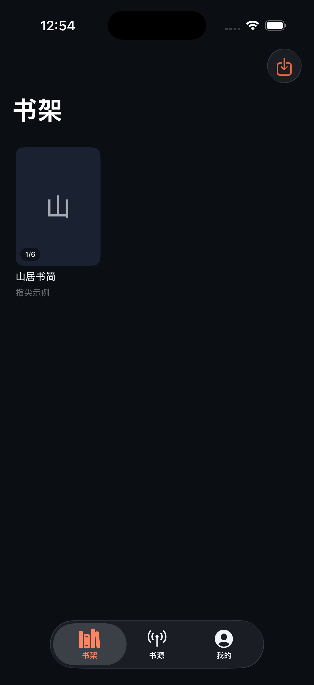
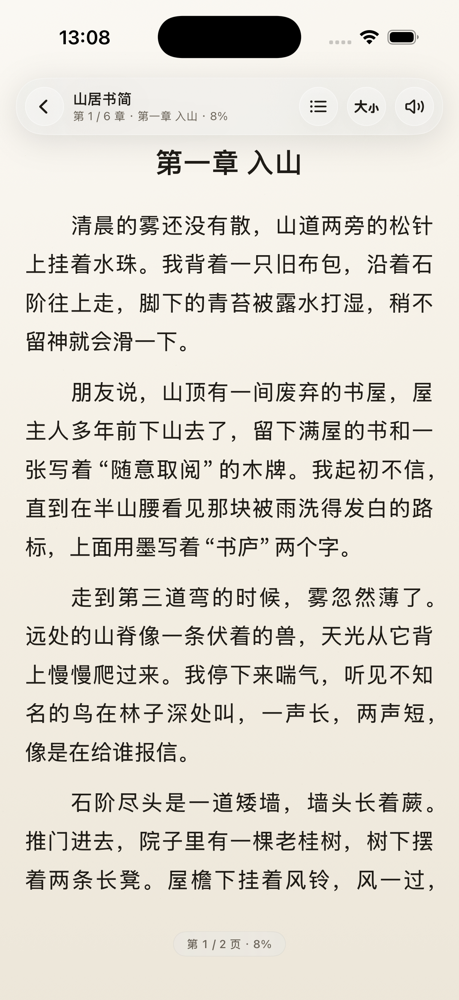
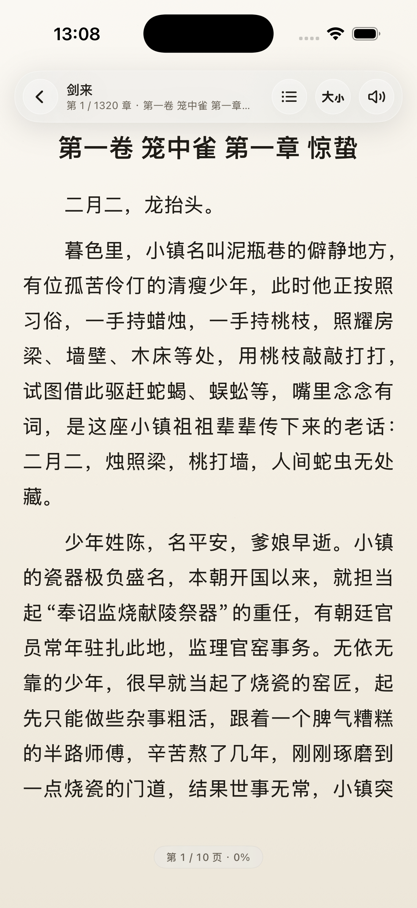
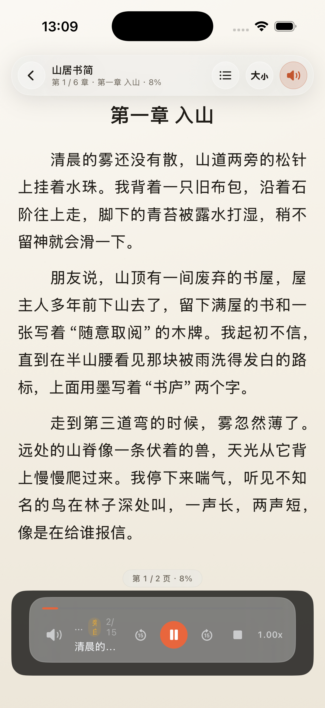

# 指尖阅读 2.0 · 重建工程

> 基于 QiReader（栖阅）逆向分析的架构重建版：全新 Xcode 工程 + 原生 TextKit 分页 + Legado 书源引擎 + 系统/HTTP 多角色 TTS + 备份/WebDAV。
> 设计语言沿用「指尖阅读」的纸感阅读 + 玻璃外壳；旧工程（`../zhijian-ios`）仅作组件参考，不直接复用 UI 架构。






## 状态（P0 已完成）

| 模块 | 状态 | 说明 |
|---|---|---|
| 书源登录/鉴权 | ✅ | loginUrl 自动调用 `login()`；loginUi 按钮执行源内 action（`login(true)`/`fq_login()`/`sethost()`…）；表单 POST 自动 `x-www-form-urlencoded`；后端 `{"error":"访问被拒绝"}` 映射为 -12 并给登录引导 |
| 书源兼容修复 | ✅ | 动态 `header`（`@js:` 求值后注入，如 `X-Novel-Token`/`X-Api-Key`）；`java.androidId()/deviceID()` 返回稳定 16 位 hex 设备码；429 按 `Retry-After` 退避；加密正文识别为可读错误 |
| 书源兼容修复 | ✅ | `<js>…</js>` 正确解包；规则 JS 每次独立词法作用域（修复 `let` 重声明）；`data:detailsUrl/catalogUrl/chapterUrl` 私有协议（payload 交给规则自解析）；POST JSON body 自动补 `Content-Type` |
| 书源引擎 | ✅ | Legado `BookSource` 全量模型（35 字段）、`AnalyzeUrl` 请求、规则链/`{{}}`/`@put`/`@get`/索引/`##`、CSS/XPath/JSONPath/正则/JS；`packages_stub.js` + 原生 `_native*`/`_jsoup*`；多源并发搜索、详情/目录/正文、`concurrentRate`、`loginCheckJs`；**登录**（`loginUi` 原生表单 / `loginUrl` WebView / `@js:` 脚本 / 登录态持久化）；TOC 归一化、诊断快照 |
| 分页阅读器 | ✅ | native TextKit 断页（`NSTextStorage+NSLayoutManager+NSTextContainer`）、UIPageViewController 左右翻页、点击左右 1/3、章节过渡页、页缓存、目录/设置 Sheet、滚动模式回退、进度持久化 |
| TTS | ✅ | 系统 `AVSpeechSynthesizer`（切句/暂停/继续/停止/语速/Now Playing/远程控制）、旁白/对话多角色、**智能角色识别**（引号归属 + 提示语 → 角色名/逐角色音色+音高）、**句级高亮 + 自动翻页/滚动**（分页/滚动/EPUB/PDF）、HTTP TTS 源（模板 / `,{JSON}` POST / `@js:`；header/Cookie；contentType 校验；缓存）、**登录页 Cookie 提取**、**WebSocket 流式播放**（文本帧 → 二进制音频 → done） |
| 备份/同步 | ✅ | `.zjbk`（ZIP + `manifest.json`，bookshelf/sources/settings/tts_sources/**annotations/paragraph_comments**）导出/恢复；WebDAV（PROPFIND/MKCOL/PUT/GET + Basic Auth）上传/下载/列表；**加密备份**（PBKDF2-SHA256 120k + AES-GCM）；**Cookie 持久化**（`cookies.json`）与 **iCloud KVS** 设置/进度/段评/章末评论/批注同步（未签名时本地镜像降级） |
| 本地书 | ✅ | TXT 导入（UTF-8/GB18030 探测）+ 自动分章；**EPUB 导入**（ZIP → container/OPF/spine → nav/ncx 标题）与 **EPUB 富文本阅读**（解包原始 XHTML/CSS/图片，WKWebView 渲染 + 主题注入 + 目录/章节切换/进度 + **分页模式**）；**PDF 导入与阅读**（PDFKit）；**漫画 CBZ/ZIP 导入**（横向分页 / 纵向长图、缩放、页码、进度） |
| 阅读增强 | ✅ | 书签、划线、笔记（分页/滚动均可选中 → 划线/笔记）、笔记列表、目录/书签/笔记三 Tab、换源；**章节标题设计器**（对齐/大小/分隔线·花饰）；**自动高亮规则**（关键词/正则 + 颜色）；**段评**（分页段落气泡 + 整章侧栏）与**章末评论**（章尾按钮/菜单入口，列表/发表、分页加载、点赞/回复/@、时间戳冲突处理）；**段评同能力**；**WebDAV 独立评论同步**（`zhijian-comments.json`，下载→合并→回传）；**EPUB 图片查看器**（点击图片全屏、缩放/双击、分享）；本地 JSON 持久化 |
| 书架布局 | ✅ | 网格/列表切换、列数 2–5、排序（最近阅读/添加时间/书名）、分组筛选与移动、分组管理；设置 → 书架布局；空书架可直接转在线搜索 |
| 搜索增强 | ✅ | 多源并发 + 分页加载更多（去重合并）、取消在途请求、180s 结果缓存、源数/总数/耗时摘要 |
| 章节缓存 | ✅ | 目录/正文落 `Caches/ChapterCache`；目录 24h TTL + 后台刷新；200 MB LRU；设置页按书/全部清理；离线可读 |
| 目录规则 | ✅ | 去重/去空/卷名识别/自动纠正倒序/编号排序/标题清理正则；全局 + 按书源覆盖；示例预览 |
| 替换净化 | ✅ | `ReplaceRule`（正则/字面量、正文/标题、顺序、1s 超时）；导入/导出 JSON、清洗预览；正文与标题清洗接入远程/本地书 |
| 发现 / Explore | ✅ | `exploreUrl`（JS/JSON/行文本）+ `ruleExplore`；书源/分类横滑、列表分页、详情、登录态徽标；书架「✨」入口 |
| 阅读统计 | ✅ | 日/年目标与进度、今日卡、本周/连续/书籍、7 日柱状、30 日趋势、年度目标、总时长/活跃天/日均；阅读页自动计时并按书记录 |
| 书源管理 | ✅ | 单条编辑（JSON/分组/启停）、分组筛选 chip、导入导出、去重、点击进入编辑 |
| jsLib 共享脚本 | ✅ | 内联或远程（磁盘缓存 24h）；注入失败写入诊断与 JS console |
| 书源体检 | ✅ | 逐源四阶段（搜索/详情/目录/正文）耗时与错误、批量体检、HTTP 流水 + JS console 诊断、一键复制；结果持久化；内置「引擎自检」 |
| 引擎兼容补强 | ✅ | fastjson、Gson；`java.getZipStringContent/getZipByteArrayContent/unzipFile` 支持 ZIP **以及 RAR/7z（iOS SDK libarchive 弱链接）**；JSC 执行超时中断（12s，可测试 2s） |
| **WebView 兜底** | ✅ | 离屏 WKWebView：`@webjs:` 规则、`java.webView/webViewGetSource/webViewGetOverrideUrl`、`ruleContent.webJs`；**网络拦截**（XHR/fetch → `ruleContent.sourceRegex` 匹配响应体/URL）；引擎自检 13/13 |
| 批量测试 | ✅ | 多关键词 × 多源、可选深度四阶段、并发 1–4、逐项结果/耗时、报告文本分享与复制 |
| 漫画阅读 | ✅ | CBZ/ZIP → 图片仓库 + manifest；横向分页、双指/双击缩放、页码滑杆、页码目录、进度持久化 |
| 设计系统 | ✅ | 全部二级页（TTS/备份/Cookie/iCloud/目录规则/替换净化/阅读设置）统一玻璃卡片；卡片按压反馈；配色切换过渡动画 |
| 设计系统（旧） | ✅ | **栖阅式 UI**：三 Tab（书架/统计/设置）、浅色玻璃渐变、圆角磨砂卡片、大标题；**5 套可切换配色**（青白玻璃/月白宣纸/雾蓝灰/暖沙可可/暗墨玻璃）；阅读器保留米宣纸/深墨/护眼绿三主题 |
| 发布准备 | ✅ | 2.1 (2)、App Icon、深色启动屏、隐私清单、2.1 未签名 IPA、未签名 Archive；签名/iCloud 检查清单与风险见 [docs/RELEASE.md](docs/RELEASE.md) |

已验证路径：本地示例书分页/跨章/主题切换；真实书源「关于小说」搜索《剑来》→ 详情 1,320 章 → 首章正文分页（1/10 页）；朗读条与 TTS 设置；备份页；Debug 模拟器构建 + Release iphoneos 构建均通过。

引擎自测（iOS 模拟器 CLI）59/59：兼容层加载、Base64/MD5/SHA/AES/DES/GZIP/JsonPath/Pattern/容器/URLEncoder/BigInteger/Android Base64/hutool/okhttp、Jsoup/JXDocument、规则链/索引/`##`/`###`/`{{}}`/`@put`/`@get`/`@webjs` 诊断、loginCheckJs、TOC 归一化。

## 构建 / 运行

```bash
# 模拟器构建
xcodebuild -project Zhijian.xcodeproj -scheme Zhijian \
  -sdk iphonesimulator -destination 'platform=iOS Simulator,name=iPhone 17' \
  -derivedDataPath build build

# 安装 + 启动
xcrun simctl boot "iPhone 17" 2>/dev/null || true
xcrun simctl install booted build/Build/Products/Debug-iphonesimulator/Zhijian.app
xcrun simctl launch booted com.zhijian.reader
```

- Bundle ID：`com.zhijian.reader`，最低 iOS 17.0，Swift 5 语言模式（Xcode 26.5 可编译）。
- 无第三方依赖（离线可构建）。

## 调试参数

| 参数 | 作用 |
|---|---|
| `-tab=0/1/2` | 启动 Tab（书架/书源/我的） |
| `-autoSearch=书名` | 启动后在书源页自动搜索 |
| `-autoOpenFirstHit` | 自动打开第一条搜索结果的详情 |
| `-autoAddHit` | 详情加载完成后自动加入书架 |
| `-autoOpenBookTitle=书名` | 书架按标题匹配并直接打开阅读器 |
| `-autoOpenFirstBook` | 打开书架第一本 |
| `-autoTTS` | 阅读页打开后自动开始朗读 |
| `-autoOpenTTSConfig` / `-autoOpenBackup` | 设置页直达朗读/备份 |
| `-seedLocalTxt` | 导入内置示例 TXT（演示本地分章） |
| `-seedEpub` | 导入内置示例 EPUB《指尖测试书》 |
| `-seedPDF` | 导入内置示例 PDF《指尖PDF示例》 |
| `-seedManga` / `-mangaPage=N` | 导入内置示例漫画《指尖漫画示例》/ 定位第 N 页（0 起） |
| `-mangaScroll` | 漫画纵向长图模式 |
| `-seedLongEpub` / `-epubPaged` / `-epubPage=N` | 导入长章 EPUB / 打开分页模式 / 定位第 N 页（1 起） |
| `-cookieTest` / `-autoOpenCookies` | 写入示例 Cookie / 打开 Cookie 管理 |
| `-cloudTest` / `-autoOpenCloud` | iCloud KVS 自检 / 打开 iCloud 同步 |
| `-pdfPage=N` | 打开 PDF 时定位到第 N 页（0 起） |
| `-seedAnnotations` | 给示例书种一条书签 + 一条划线 + 一条笔记（调试用） |
| `-showCatalog` / `-catalogTab=notes` | 阅读页自动打开目录/书签/笔记 |
| `-showChangeSource` | 阅读页自动打开换源 |
| `-showHealth` / `-showHealthDetail` | 打开书源体检 / 首个书源详情 |
| `-seedLoginSource` / `-showSourceLogin` | 导入登录测试源 / 打开其登录表单 |
| `-seedExploreSource` / `-autoExplore` | 导入发现测试源 / 打开发现页 |
| `-showAppearance` / `-palette=qingbai\|yuebai\|wulan\|nuansha\|anmo` | 打开外观页 / 切换配色 |
| `-seedReplaceRules` / `-autoOpenReplaceRules` | 种入示例替换规则 / 打开替换净化 |
| `-replaceRuleTest` | 替换引擎自检（写 replace-rule-test.txt） |
| `-chapterRuleTest` / `-autoOpenChapterRules` | 目录规则自检 / 打开目录规则页 |
| `-chapterCacheTest` / `-autoOpenChapterCache` | 章节缓存自检 / 打开缓存管理 |
| `-searchPageTest` | 搜索分页/缓存自检（写 search-page-test.txt） |
| `-titleTemplateTest` / `-showTitleDesigner` | 标题模板快照自检 / 打开设计器 |
| `-readerImageTest` / `-readerBackgroundTest` | 正文图片提取与附件自检 / 生成背景图测试 |
| `-twoPageTest` / `-forceTwoPage` | 启用双页 / 强制双页（小屏验证） |
| `-importSourceFile=<文件名>` | 启动时从 App 容器导入书源 JSON（联调真实书源） |
| `-exploreDiag` / `-exploreDetail` | 发现页诊断（分类/列表/详情/目录/正文写 explore-diag.txt） |
| `-readerDiag` | 阅读链路自检（搜索→详情→目录→正文，写 reader-diag.txt） |
| `-showShelfLayout` | 打开书架布局设置 |
| `-autoSubmitLogin` | 登录 Sheet 自动提交（调试） |
| `-autoHealthCheck` | 打开体检后自动跑全部书源 |
| `-engineSelfTest` | 打开引擎自检（fastjson/Gson/ZIP/WebView） |
| `-showBatchTest` / `-autoBatchTest` | 打开批量测试 / 自动开始 |
| `-backupCryptoTest` | 调试：加密导出 → 解密 → 恢复自检 |
| `-backupEncryptOn` | 打开备份页并开启加密（预填测试密码） |
| `-ttsCharacterTest` | 播放含「阿禾/老陈」的样本文本并展示角色识别 |
| `-wsTTSTest` | 用本地 ws://127.0.0.1:8766 测试 WebSocket 流式朗读 |
| `-pdfTTS` | 打开 PDF 后自动朗读当前页 |
| `-systemTTS` | 清除 HTTP TTS 选择，强制系统朗读 |
| `-seedHighlightRules` | 种入「雾 / 书庐」两条高亮规则 |
| `-titleDesign` | 应用左对齐 + 1.5x + 分隔线标题样式 |
| `-showReaderSettings` | 阅读页自动打开阅读设置 |
| `-readerPaged` | 强制分页模式（调试段评气泡） |
| `-seedParagraphComments` / `-showParagraphComments` | 种入段评 / 打开第 2 段段评 |
| `-showEpubImage` | 打开示例 EPUB 章节内嵌图片查看器 |

## 架构

```
Zhijian/
├── App/                  # 入口、RootView、AppEnvironment（依赖容器）
├── Core/
│   ├── Models/           # Legado 模型、书/章节、TTS/WebDAV/备份、协议
│   ├── Parsing/          # HTMLDocument / CSSSelector / XPathQuery / JSONPath / HtmlFormatter
│   ├── Rules/            # RuleEngine（规则链/CSS/XPath/JSON/JS/正则/变量）
│   ├── Runtime/          # JSRuntime + Java 兼容（JSRuntime+JavaCompat/Native/Jsoup）
│   ├── Pipeline/         # SourcePipeline（search/bookInfo/toc/content + HTTP/Cookie/限速）
│   ├── Reader/           # PaginationEngine / ReaderViewModel / BookContentService
│   ├── TTS/              # TTSController / HTTPTTSDriver / TTSSourceStore / WebSocket
│   ├── Sync/             # BackupService / WebDAVClient / ZipArchive
│   └── Store/            # BookStore / SourceStore / LocalLibrary / 导入
├── Features/             # Shelf / Sources / Reader / TTS / Settings
├── Design/               # ZJ 设计令牌
└── Resources/            # packages_stub.js / jsoup_bridge.js / 示例书源/示例书
```

## 与旧工程的差异

1. **阅读器**：旧版为 `UITextView` 纵向滚动；新版为 native TextKit 分页 + 页缓存 + 章间过渡。
2. **书源引擎**：旧版 `JSRuntime` 只实现少量 `java.*`；新版加入 Rhino/Java 兼容包（`packages_stub.js`）与原生下沉 API，覆盖加密/摘要/容器/编码/GZIP/JsonPath/jsoup。
3. **TTS**：旧版只有系统朗读；新版加入 HTTP TTS 源、多角色、音频缓存与迷你播放条。
4. **备份**：旧版为 zip 全量；新版 `.zjbk` + manifest + 分类 + WebDAV。
5. **工程结构**：全新目录分层（Core/Features/Design），旧工程未改动。

## 数据位置

- 应用数据：`Application Support/Zhijian/`（bookshelf.json / sources.json / settings.json / local_library.json / tts_sources.json / webdav.json）
- 备份：`.zjbk`（ZIP，未加密；UI 已提示敏感性）
- 书源/书籍仅用户导入；仓库不预置第三方书源（`demo-source-rulianshi.json` 仅用于开发验证，发布前请移除或替换）。

## 与栖阅对比

详细逐项对比（引擎/阅读器/TTS/同步/生态/安全 + 优先补齐建议）见 [docs/QIREADER-COMPARISON.md](docs/QIREADER-COMPARISON.md)；按对比拆出的可执行任务清单见 [docs/BACKLOG.md](docs/BACKLOG.md)。

## 已知缺口 / 下一步

- 阅读器：图片、章节标题 HTML 设计器尚未接回；跨章为过渡页重载（非无缝）；滚动模式暂不支持选区划线。
- 引擎：验证码/`startBrowser` 交互浏览器、RAR/7z 解码、JSC 执行超时中断；`sourceRegex` 目前只捕获页面加载后 2.5s 内的 XHR/fetch（不修改请求头）。
- TTS：角色识别仍是本地启发式（未接大模型）；WebSocket 约定为发送文本帧、接收二进制音频帧 + `{"type":"done"}`。
- 验证：`-ttsCharacterTest` 识别「阿禾/老陈」；分页/滚动/EPUB 三种阅读器句级高亮；本地 ws://127.0.0.1:8766 返回 151,644 字节 WAV 并成功播放。
- 同步：iCloud 文档镜像、备份加密、Cookie 迁移；WebDAV 密码目前明文（UI 已提示）。
- 本地书：EPUB 富文本、PDF 已支持；漫画未开始。
- 发布：图标/启动图/隐私清单已就位；TestFlight 签名与元数据待补。

## 合规

- 本工程为自有代码重建：书源格式与协议按 Legado 公开规范实现，未复制 QiReader、Legado（GPL）、origo-x（AGPL）的代码或资源。
- 不预置书源、不内置内容；用户导入的书源与内容版权归原站/作者。
